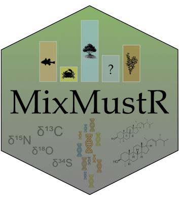

MixMustR description 
=========================================================================================

[![Ask Us Anything][0a]][0b]
![Open Source Love][0c]
[](https://choosealicense.com/)

[0a]: https://img.shields.io/badge/Ask%20us-anything-1abc9c.svg
[0b]: https://github.com/open-aims/MixMustR_paper/issues/new
[0c]: https://badges.frapsoft.com/os/v2/open-source.svg?v=103

# MixMustR paper

# Package

https://github.com/open-aims/MixMustR

## Bayesian mixture model

## Instructions

All analyses were done in `R`. This routine uses the [targets](https://github.com/ropensci/targets) R package to produce all outputs. First install `targets`:

```r
install.packages("targets")
```

Next you need to open an R session with working directory set to the root of the project.

This routine uses some packages detailed under `_targets.R`, so make sure to install them before running anything.

Then, to generate the analyses and output visualisations simply run:

```r
source("run.R")
```

Then, to load in each of the targets from `_targets.R` simply run in an R session:

```
targets::tar_load(target_name)
```

## License

This repository is provided by the authors under the MIT License ([MIT](http://opensource.org/licenses/MIT)).

## Bug reporting
* Please [report any issues or bugs](https://github.com/open-aims/MixMustR_paper/issues).
